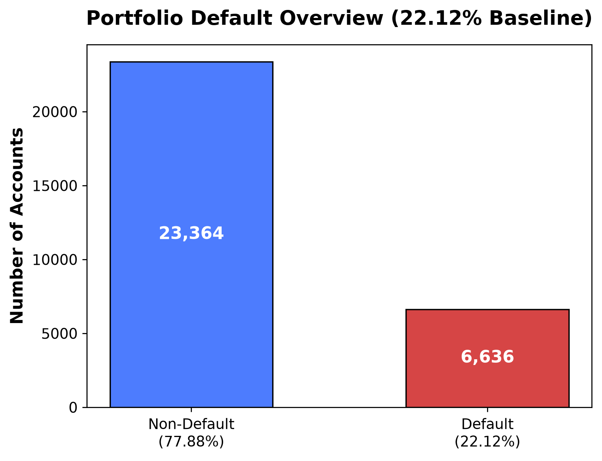

# Credit Risk & Customer Financial Health Analytics

An end-to-end data science case study of credit-card repayment risk and customer portfolio health. Using 30,000 historical accounts from the [UCI Default of Credit Card Clients dataset](https://archive.ics.uci.edu/dataset/350/defaultofcreditcardclients), the project cleans the data, explores default patterns, builds interpretable risk segments, and turns the findings into responsible customer-management recommendations.

The analysis uses a fictional business scenario, **FinTrust Digital Finance**. Monetary amounts in the source data are in New Taiwan dollars (TWD/NTD).

## Key findings

| Finding | Result |
| --- | ---: |
| Accounts that defaulted in the following month | 6,636 of 30,000 (22.12%) |
| Default rate with no delayed payment months | 11.7% |
| Default rate with delays in all six months | 70.3% |
| Share of simplified expected loss in the At-Risk segment | About 53% |
| Customers with high utilisation and poor repayment | 34.6% of accounts, but 45.5% of observed defaults |

Repeated payment delay is the strongest observed warning pattern. The At-Risk segment represents the largest estimated loss pool even though the smaller Critical segment has the highest default rate. These are historical associations and prioritisation estimates, not predictions for an individual customer.



## What the project covers

1. **Data preparation:** Validate the raw data, retain meaningful edge cases, and create repayment and balance features.
2. **Exploratory analysis:** Compare default patterns across repayment history, financial position, credit limits, and demographic groups.
3. **Risk segmentation:** Combine delinquency, repayment capacity, exposure, and balance trajectory into four interpretable segments: Healthy, Watchlist, At-Risk, and Critical.
4. **Portfolio strategy:** Examine utilisation and repayment together, estimate exposure by segment, and propose proportionate support and review actions.
5. **External data:** Use the public [ExchangeRate-API Open Access endpoint](https://www.exchangerate-api.com/docs/free) for a TWD-to-USD *reporting view*. The exchange rate does not affect risk scores or customer treatment.

## Repository contents

| Path | Purpose |
| --- | --- |
| [`credit_risk_technical_appendix.ipynb`](credit_risk_technical_appendix.ipynb) | Complete, executable analysis covering all five phases. Start here for the methods and code. |
| [`default of credit card clients.csv`](default%20of%20credit%20card%20clients.csv) | Raw source data used by the notebook. |
| [`cleaned_credit_data.csv`](cleaned_credit_data.csv) | Phase 1 output used by later phases; 30,000 rows and 34 columns. |
| [`figures/`](figures/) | 18 exported analysis charts. |
| [`reports/Strategic_Insights_Report.pdf`](reports/Strategic_Insights_Report.pdf) | Executive-facing findings, recommendations, assumptions, and limitations. |
| [`requirements.txt`](requirements.txt) | Python packages used to run the notebook. |

Working drafts and separate phase notebooks are kept locally in `docs/`, which is excluded from this repository's current file set.

## Run the notebook

The environment was prepared with **Python 3.14**. From the repository root, create a virtual environment and run JupyterLab with that environment's Python.

On Windows (PowerShell):

```powershell
python -m venv .venv
.\.venv\Scripts\python.exe -m pip install -r requirements.txt
.\.venv\Scripts\python.exe -m jupyter lab
```

On macOS or Linux:

```bash
python3 -m venv .venv
.venv/bin/python -m pip install -r requirements.txt
.venv/bin/python -m jupyter lab
```

In JupyterLab, open `credit_risk_technical_appendix.ipynb`, select the installed Python kernel, and run all cells from a clean kernel in order. Keep the notebook's working directory at the repository root so its relative paths resolve.

Phase 1 regenerates `cleaned_credit_data.csv`; later phases regenerate charts in `figures/`. Phase 5 needs an internet connection for the live exchange-rate call. Its rate and timestamp can differ from the saved notebook output. You can read the saved results without running the notebook.

## Method and responsible use

The scoring framework is an **interpretable prioritisation tool**, not a calibrated probability-of-default model. The simplified expected-loss calculation assumes 100% loss given default and no recovery; it is not an accounting estimate. The data are historical and observational, so the findings do not establish causation or guarantee future performance.

Demographic fields are used for descriptive analysis and fairness monitoring, not as automatic triggers for adverse credit action. Any decision affecting credit access would require individual review, an understandable reason, and a way for the customer to respond. The [report](reports/Strategic_Insights_Report.pdf) and notebook discuss further limitations.

## Sources and attribution

- **Dataset:** Yeh, I. (2009). *Default of Credit Card Clients*. UCI Machine Learning Repository. [Dataset record and citation](https://archive.ics.uci.edu/dataset/350/defaultofcreditcardclients). The dataset is published under [CC BY 4.0](https://creativecommons.org/licenses/by/4.0/).
- **Exchange-rate data:** [ExchangeRate-API Open Access](https://www.exchangerate-api.com/docs/free). Its public endpoint provides the reporting-only currency snapshot used in Phase 5.

This project was completed as an academic data science case study. The notebook and report describe the analysis, assumptions, and acknowledgements in detail.
